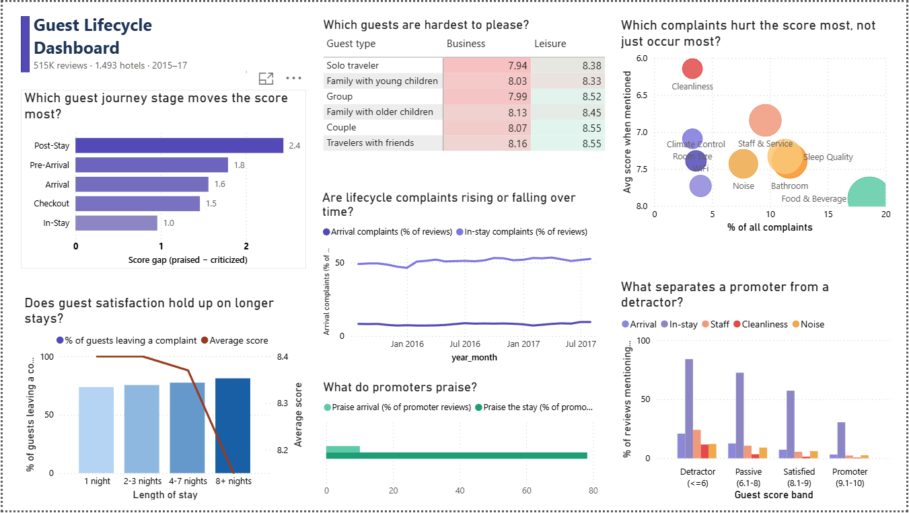

# Guest Lifecycle Dashboard

Where does the guest experience break down: before arrival, at check-in, during the stay or at checkout? This project answers that from 515,738 Booking.com reviews of 1,493 European hotels, using Python, SQL and Power BI, and turns each finding into an action a hotel team could take.



## At a glance

| Measure | Result |
|---|---|
| Reviews analysed | 515,738 from 1,493 hotels |
| Period | Aug 2015 – Aug 2017 |
| Average review score | 8.39 out of 10 |
| Promoters (score 9.1–10) | 48% of reviews |
| Detractors (score 6 or below) | 10% of reviews |

## The questions

1. Which stage of the guest journey moves the review score most?
2. Which complaints do the most damage, not just which are the most common?
3. Which guests are hardest to please?
4. Does satisfaction hold up on longer stays?
5. What separates a promoter from a detractor?
6. Are complaints getting better or worse over time?

## Findings and recommendations

### 1. Problems before and at arrival hurt the score more than problems during the stay

When a guest complains about the booking or contact before arrival, their average score is 7.01. For arrival and check-in it is 7.18, and for checkout 7.17. For complaints about the stay itself, it is 7.74.

In-stay comments are everywhere: half of all reviews mention a gripe about the room, the bed or the breakfast, including many happy guests. Pre-arrival and arrival complaints are rarer, but when they appear the guest is usually unhappy. A detractor is 6.5 times as likely as a promoter to mention an arrival problem (20.9% against 3.2%), compared with 2.8 times for in-stay problems (84.0% against 30.5%).

Post-Stay shows the largest gap on the dashboard (2.4 points), but its keywords, such as "recommend", "come back" and "never again", capture the guest's overall verdict, so a large gap is built in. It doesn't show that follow-up after the stay drives the score.

**What to do**

- Confirm every booking with an automated pre-arrival message covering dates, room type, special requests, check-in time and directions.
- Plan the arrival as carefully as the room: staff the desk for peak arrival times, offer online check-in and tell guests when their room is ready.
- Report pre-arrival and arrival complaints as their own measure, not buried inside an overall satisfaction score.

### 2. Cleanliness and staff attitude are the deal-breakers

Cleanliness appears in only 3.3% of complaints, but when it does, the average score drops to 6.14, the lowest of any issue. Staff and service complaints come next at 6.84. Food and beverage is the most common complaint (18.6%) but does the least damage (7.90).

Comparing happy and unhappy guests shows the same thing. Detractors mention cleanliness 29 times as often as promoters (11.7% against 0.4%) and staff problems 10 times as often (24.1% against 2.4%).

**What to do**

- Treat cleanliness as a zero-defect standard: supervisor spot checks, with repeat issues tracked by room.
- Train staff in service recovery. A complaint about staff attitude costs more score than a complaint about the room.
- Fix the most damaging issues before the most common ones. Breakfast complaints are frequent but cost the least.

### 3. Business travellers are the hardest guests to please

Every business segment scores lower than its leisure equivalent. Solo business travellers are the lowest at 7.94, while leisure couples, the largest group, are among the highest at 8.55. Overall, business guests average 8.0 against 8.5 for leisure, and report more problems at arrival (8.7% against 7.9% of reviews) and during the stay (55.3% against 50.1%).

**What to do**

- Make arrival fast for business guests: express or mobile check-in, and mobile keys where the hotel has them.
- Guarantee room readiness for confirmed business arrivals.
- Give business guests a direct line, such as chat or WhatsApp, for quick fixes during the stay.

### 4. Satisfaction slips on long stays

The share of guests writing something in the negative box rises with length of stay, from 73.7% for one night to 81.2% for eight nights or more. Scores hold at about 8.4 for stays of up to a week, then drop to 8.15. Cleanliness complaints are 65% more common on 8+ night stays than on one-night stays (3.8% against 2.3%), and staff complaints rise from 6.9% to 8.8%.

Small issues add up: a missed towel change or a slow repair matters more on day eight than on day one. Stays of 8+ nights are only 1.2% of reviews, so this is a smaller group.

**What to do**

- For stays of a week or more, schedule a mid-stay courtesy call and a supervisor room check.
- Flag open maintenance requests on long-stay rooms so nothing is still open at checkout.

### 5. Complaint levels barely moved in two years

Complaint rates held steady across the period, with a slow upward drift. In-stay complaints appear in about half of all reviews every month, edging up from 48.6% (Aug–Dec 2015) to 52.3% (Jan–Aug 2017). Arrival complaints rose from 7.8% to 8.4%, and run highest in the busiest months (9.5% in July 2017) against about 7% in winter.

These are persistent, built-in problems, not a temporary dip. They need process changes, not a one-off push.

**What to do**

- Review complaints by stage every month, the way revenue is reviewed: same report, same time, with an owner for each stage.
- Plan extra arrival capacity for the peak months.
- Automate the report. The same tagging used here can run on new reviews every week.

## How the lifecycle tagging works

Each review is tagged to the journey stages it mentions, using keyword lists. A review can be tagged to several stages. Booking.com already splits each review into a positive box and a negative box, so a keyword in the negative box counts as a complaint about that stage, and a keyword in the positive box counts as praise.

| Stage | Example keywords |
|---|---|
| Pre-arrival | booking, reservation, confirm, email, request |
| Arrival | check-in, reception, lobby, queue, luggage |
| In-stay | room, bed, shower, staff, breakfast, wifi |
| Checkout | check-out, bill, payment, charged |
| Post-stay | recommend, come back, value for money, never again |

The same method splits complaints into nine issues: cleanliness, noise, room size, bathroom, sleep quality, staff and service, food and beverage, wifi and climate control.

The dashboard's score bands are Detractor (6 or below), Passive (6.1–8), Satisfied (8.1–9) and Promoter (9.1–10). They are this project's own bands, based on the Net Promoter idea, not Booking.com categories.

## How it was built

```
Booking.com reviews (CSV, 515,738 rows)
  → Python: clean, extract guest details, tag stages and issues    python/clean_reviews.py
  → SQLite: one cleaned reviews table
  → SQL: six queries, one per dashboard panel                      sql/queries.sql
  → Power BI: the dashboard                                        powerbi/
```

| Folder | What's inside |
|---|---|
| `python/` | `clean_reviews.py` cleans the reviews, pulls trip type, traveller type and stay length from the review tags, and tags each review by stage and issue |
| `sql/` | `queries.sql`, the six queries behind the dashboard panels |
| `powerbi/` | `guest_lifecycle_dashboard.pbix` (opens with the data loaded) and `guest_lifecycle_dashboard.pbit` (template version, no data) |
| `images/` | Dashboard snapshot |

## Data notes and limitations

**Source:** [515K Hotel Reviews Data in Europe](https://www.kaggle.com/datasets/jiashenliu/515k-hotel-reviews-data-in-europe) on Kaggle, collected from Booking.com. The raw file (230MB+) isn't included here; download it from the link.

**Cleaning:** trimmed stray spaces, labelled 523 blank nationalities as Unknown, flagged Booking.com's "No Negative" and "No Positive" placeholders so they aren't read as feedback, and filled the few missing stay lengths with the median rather than dropping the review.

**Worth knowing when reading the numbers:**

- **Keyword tagging reads words, not meaning.** "Not dirty" still counts as a cleanliness mention. It's simple and transparent, so treat the results as strong patterns rather than exact counts.
- **In-stay keywords are broad** (room, staff, breakfast), so most reviews touch that stage.
- **Post-stay keywords capture the overall verdict**, so that stage's large score gap is partly built in.
- **Complaint rate** counts any text in the negative box. Some guests write "nothing" there, so the true complaint rate is lower. Comparisons between groups still hold.
- **August 2017 is a partial month** (4,078 reviews against about 20,000 in a normal month).
- **Reviewers are self-selected**, so they aren't a perfect sample of all guests.

## How to open it

1. Download `powerbi/guest_lifecycle_dashboard.pbix` and open it in Power BI Desktop (free). The data is already loaded.
2. To rebuild from the raw data: run `python/clean_reviews.py` on `Hotel_Reviews.csv`, load the output (`reviews_lifecycle_clean.csv`) into SQLite as a table called `reviews`, run the queries in `sql/queries.sql`, save the results as `Query 1.csv` to `Query 6.csv`, then point the Power Query sources at those files.

**Tools:** Python (pandas) · SQLite · SQL · Power BI (Power Query)

## About

Built by Mahesh Sambare, a hotel front office leader moving into hospitality technology and automation. [LinkedIn](https://www.linkedin.com/in/mahesh-sambare)
