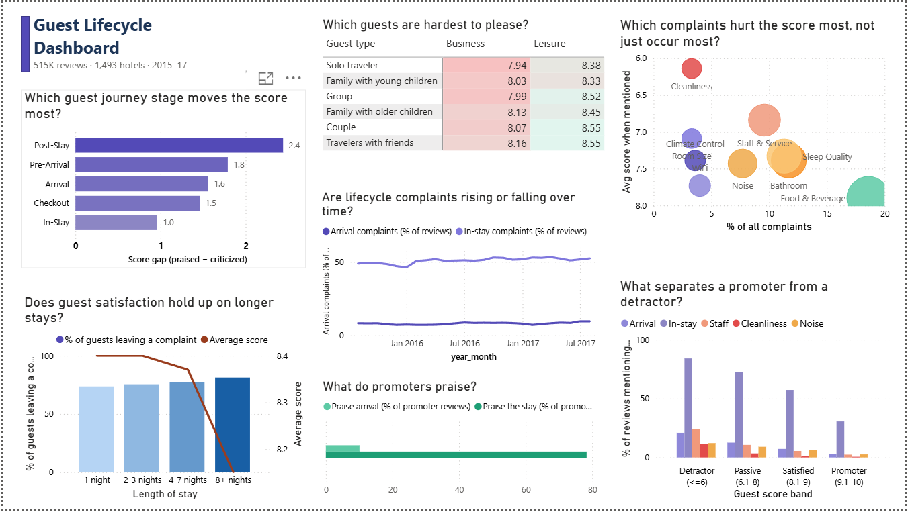

# Guest Lifecycle Analysis

Where does the guest experience break down: before arrival, at check-in, during the stay or at checkout? And if you ran guest experience for a whole hotel group, where would you start? This project answers both from 515,738 Booking.com reviews of 1,492 European hotels, using Python, SQL and Power BI.

> [!NOTE]
> **Read this first: how this was done, and its limits**
>
> This is a keyword-based analysis, not a machine learning model. Each review is tagged to stages of the guest journey and to common issues by matching words in the review text (see [How the lifecycle tagging works](#how-the-lifecycle-tagging-works)). I built it with the tools I work with today, Python, SQL and Power BI, so the method is simple and anyone can check it.
>
> - **Keyword tagging reads words, not meaning.** "Not dirty" still counts as a cleanliness mention. Read every figure as a strong pattern, not an exact count.
> - **Reviews are a self-selected sample** from one site (Booking.com), written between August 2015 and August 2017.
> - **Brands were matched from hotel names**, so the brand comparison covers about 210 hotels in 8 brand families. Brand names are withheld on purpose.
> - **The staged plan is what I would test**, not proof that it would work.



## At a glance

| Measure | Result |
|---|---|
| Reviews analysed | 515,738 from 1,492 hotels in six cities |
| Hotels compared one by one | 1,080 (those with 100+ reviews, 95% of all reviews) |
| Period | Aug 2015 – Aug 2017 |
| Average review score | 8.39 out of 10 |
| Promoters (score 9.1–10) | 48% of reviews |
| Detractors (score 6 or below) | 10% of reviews |

## Part 1: The portfolio view

Most review analysis looks at one hotel at a time. Here all 1,492 hotels are treated as one hotel group, the way a brand operations team or a consultant would see them, to answer one question: **if you ran guest experience for all of these hotels, where would you start?**

Hotels are compared only if they have 100 or more reviews, so a handful of reviews can't swing a hotel's numbers. A hotel is "flagged" on a problem when its complaint rate is clearly above the group average for its number of reviews (more than two standard errors), not just a little higher.

### 1. Most of the difference sits at property level, not with the brand

Knowing a hotel's brand or city tells you very little about its complaint levels. Brand explains between 1% and 9% of the differences between hotels in pre-arrival, arrival, staff and cleanliness complaints, and city explains between 1% and 6%. Most of the difference sits at property level. That doesn't mean all of it is down to how each hotel is run: building, location, guest mix and chance all sit at property level too.

Inside one brand family of nearly 40 hotels, arrival complaints ranged from 4.6% to 15.6% of reviews. Every large brand family showed at least a twofold gap between its best and worst hotel.

Brand standards are written once, but they're delivered hotel by hotel, and the delivery is where the difference shows. The pattern holds when only hotels with 300+ reviews are compared: brand still explains no more than 14%.

### 2. Front-of-house problems come as a bundle

Hotel by hotel, arrival, staff and pre-arrival complaints rise and fall together:

| Hotel complaint rates | Correlation across hotels |
|---|---|
| Arrival and staff | 0.70 |
| Pre-arrival and arrival | 0.60 |
| Pre-arrival and staff | 0.54 |
| Noise and staff | 0.09 |

123 hotels (11% of those compared) are flagged on at least two of pre-arrival, arrival and staff complaints. They hold 21% of reviews but about 30% of the pre-arrival, arrival and staff complaints, and a third of the cleanliness complaints. Their average score is 7.8, against 8.65 for hotels with no flags.

Three symptoms, possibly one root cause somewhere between the booking confirmation and the welcome at the desk. The data shows they occur together; finding the cause is what the diagnosis stage of the plan is for.

### 3. Busy hotels struggle most at arrival

| Hotels split into fifths by guest volume | Arrival complaints | Staff complaints | Average score |
|---|---|---|---|
| Quietest fifth | 6.4% | 5.5% | 8.72 |
| Busiest fifth | 8.8% | 7.9% | 8.29 |

Across all hotels, arrival complaints peak in July (9.1%) and are lowest in February (7.1%). Guest volume is measured by each hotel's total number of reviews on Booking.com, which is a proxy, not a room count.

### 4. Not every problem is a process problem

Each type of problem behaves differently across the group, so each needs a different owner:

| Problem | How it shows up across hotels | Who should own it | What to do |
|---|---|---|---|
| Pre-arrival, arrival, staff | Occur together, in the lowest-scoring hotels | Group operations and brand standards, with hotel GMs | One redesigned front-of-house process, piloted first |
| Cleanliness | Concentrated: the worst 10% of hotels produce 31% of cleanliness complaints | Regional operations and quality | Targeted housekeeping audits and recovery in those hotels |
| Noise, heating and air-con | Stay in the same hotels year after year and barely relate to service | Asset management and owners | A capital spending list; manage room allocation and guest expectations in the meantime |
| Food and beverage | Widespread: the worst 10% of hotels hold only 13% of these complaints, and they have little impact on scores | Brand food and beverage | Review the product later; low priority |

Noise is the stickiest problem in the data: 67% of the hotels in the worst quarter for noise in the first year were still there a year later. That points to buildings and locations, not to how the hotel is run.

### 5. The bottom tends to stay the bottom

Comparing the first year of reviews (Aug 2015 – Jul 2016) with the second (Aug 2016 – Aug 2017) for the 767 hotels with 75+ reviews in both years:

| Measure | Worst quarter in year 1 still worst in year 2 | Reached the better half |
|---|---|---|
| Review score | 77% | 1% |
| Staff complaints | 58% | 16% |
| Arrival complaints | 53% | 17% |
| Cleanliness complaints | 60% | 15% |
| Noise complaints | 67% | 10% |

Poor performance rarely corrected itself over the period. The data can't show what, if anything, these hotels tried, only that most of them stayed where they were.

### What fixing it could be worth

If every hotel worse than the middle hotel were brought up to it, the group would have about 21% fewer arrival complaints, 22% fewer staff complaints, 23% fewer pre-arrival complaints and 42% fewer cleanliness complaints. That's a ceiling for planning, not a forecast.

### How these figures were calculated

- **Which hotels:** only hotels with 100+ reviews are compared (1,080 hotels, 95% of reviews). Each hotel's complaint rate is the share of its reviews that mention a stage or issue in the negative box.
- **"Brand explains 4%":** the share of the variation in hotel complaint rates that sits between groups rather than within them (between-group sum of squares divided by total sum of squares). City uses all 1,080 hotels. Brand uses the 8 brand families with 15+ hotels (212 hotels), matched from hotel names. Part of the remaining variation is random noise from review counts (roughly 10–20%), so "property level" means everything specific to the hotel plus chance.
- **Flagged hotels:** a hotel is flagged when its complaint rate is more than two standard errors above the group average for its number of reviews.
- **Year on year:** year 1 is Aug 2015 – Jul 2016 and year 2 is Aug 2016 – Aug 2017. Hotels with 75+ reviews in both years (767) are split into quarters in each year separately, and the table shows how many of year 1's worst quarter were still in the worst quarter in year 2.
- **Correlations:** Pearson correlation between hotels' complaint rates, one value per hotel.
- **Guest volume:** each hotel's total Booking.com review count, used as a proxy for how many guests it handles.

All of these are associations in review data. None of them proves what causes a hotel's complaints.

## The staged plan

Sending every hotel a new standard wouldn't work: the data says the standard isn't the main problem, the delivery is. So the plan starts small, with the hotels that struggle most, and scales only what works.

| Stage | When | What happens | How we'd know it worked |
|---|---|---|---|
| 0. Baseline | Weeks 0–4 | Build one scorecard showing every hotel's complaint rate at each stage of the guest journey, refreshed weekly by the same tagging. Group hotels into tiers: Tier 1 is the 123 front-of-house hotels, Tier 2 the cleanliness outliers, Tier 3 the rest. Name an owner for each stage at group level and at each hotel. | Every hotel can see its own numbers every week, and every stage has an owner |
| 1. Diagnose and design | Months 1–3 | Visit a sample of Tier 1 hotels and the best hotels of the same brand and city, find what the best do differently, and adapt it. Map today's pre-arrival and arrival process, then design one future process: automated booking confirmation, a room-readiness promise, arrival staffing matched to forecast arrivals, online check-in for high-volume hotels, and a service-recovery script. | One process design and a training pack, tested with frontline teams |
| 2. Pilot | Months 3–6 | Run the new process in 10–15 Tier 1 hotels across different cities, with similar hotels as a comparison group. Train Team Leads first and hold weekly huddles on the scorecard. | Arrival and staff complaints fall faster in pilot hotels than in the comparison group |
| 3. Scale | Months 6–12 | Roll out in waves by region and build the process into brand standards and audits. In parallel, run housekeeping recovery in Tier 2 hotels and hand the noise and heating list to asset management. | Tier 1 hotels move towards the middle of the group |
| 4. Sustain | Ongoing | Review the portfolio monthly, the way revenue is reviewed. Send an alert when a hotel crosses its threshold at any stage. | Gains hold for two quarters or more |

## Part 2: Guest-level findings

The original analysis, review by review. These findings explain why the plan above starts with pre-arrival and arrival, and what a single hotel can do on its own.

### 1. Problems before and at arrival hurt the score more than problems during the stay

When a guest complains about the booking or contact before arrival, their average score is 7.01. For arrival and check-in it is 7.18, and for checkout 7.17. For complaints about the stay itself, it is 7.74.

In-stay comments are everywhere: half of all reviews mention a gripe about the room, the bed or the breakfast, including many happy guests. Pre-arrival and arrival complaints are rarer, but when they appear the guest is usually unhappy. A detractor is 6.5 times as likely as a promoter to mention an arrival problem (20.9% against 3.2%), compared with 2.8 times for in-stay problems (84.0% against 30.5%).

Post-Stay shows the largest gap on the dashboard (2.4 points), but its keywords, such as "recommend", "come back" and "never again", capture the guest's overall verdict, so a large gap is built in. It doesn't show that follow-up after the stay drives the score.

**What a hotel team can do**

- Confirm every booking with an automated pre-arrival message covering dates, room type, special requests, check-in time and directions.
- Plan the arrival as carefully as the room: staff the desk for peak arrival times, offer online check-in and tell guests when their room is ready.
- Report pre-arrival and arrival complaints as their own measure, not buried inside an overall satisfaction score.

### 2. Cleanliness and staff attitude are the deal-breakers

Cleanliness appears in only 3.3% of complaints, but when it does, the average score drops to 6.14, the lowest of any issue. Staff and service complaints come next at 6.84. Food and beverage is the most common complaint (18.6%) but does the least damage (7.90).

Comparing happy and unhappy guests shows the same thing. Detractors mention cleanliness 29 times as often as promoters (11.7% against 0.4%) and staff problems 10 times as often (24.1% against 2.4%).

**What a hotel team can do**

- Treat cleanliness as a zero-defect standard: supervisor spot checks, with repeat issues tracked by room.
- Train staff in service recovery. A complaint about staff attitude costs more score than a complaint about the room.
- Fix the most damaging issues before the most common ones. Breakfast complaints are frequent but cost the least.

### 3. Business travellers are the hardest guests to please

Every business segment scores lower than its leisure equivalent. Solo business travellers are the lowest at 7.94, while leisure couples, the largest group, are among the highest at 8.55. Overall, business guests average 8.0 against 8.5 for leisure, and report more problems at arrival (8.7% against 7.9% of reviews) and during the stay (55.3% against 50.1%).

**What a hotel team can do**

- Make arrival fast for business guests: express or mobile check-in, and mobile keys where the hotel has them.
- Guarantee room readiness for confirmed business arrivals.
- Give business guests a direct line, such as chat or WhatsApp, for quick fixes during the stay.

### 4. Satisfaction slips on long stays

The share of guests writing something in the negative box rises with length of stay, from 73.7% for one night to 81.2% for eight nights or more. Scores hold at about 8.4 for stays of up to a week, then drop to 8.15. Cleanliness complaints are 65% more common on 8+ night stays than on one-night stays (3.8% against 2.3%), and staff complaints rise from 6.9% to 8.8%.

Small issues add up: a missed towel change or a slow repair matters more on day eight than on day one. Stays of 8+ nights are only 1.2% of reviews, so this is a smaller group.

**What a hotel team can do**

- For stays of a week or more, schedule a mid-stay courtesy call and a supervisor room check.
- Flag open maintenance requests on long-stay rooms so nothing is still open at checkout.

### 5. Complaint levels barely moved in two years

Complaint rates held steady across the period, with a slow upward drift. In-stay complaints appear in about half of all reviews every month, edging up from 48.6% (Aug–Dec 2015) to 52.3% (Jan–Aug 2017). Arrival complaints rose from 7.8% to 8.4%, and run highest in the busiest months (9.5% in July 2017) against about 7% in winter.

These are persistent, built-in problems, not a temporary dip. They need process changes, not a one-off push.

**What a hotel team can do**

- Review complaints by stage every month, the way revenue is reviewed: same report, same time, with an owner for each stage.
- Plan extra arrival capacity for the peak months.
- Automate the report. The same tagging used here can run on new reviews every week.

## How the lifecycle tagging works

Each review is tagged to the journey stages it mentions, using keyword lists. A review can be tagged to several stages. Booking.com already splits each review into a positive box and a negative box, so a keyword in the negative box counts as a complaint about that stage, and a keyword in the positive box counts as praise.

| Stage | Example keywords |
|---|---|
| Pre-arrival | booking, reservation, confirm, email, request |
| Arrival | check-in, reception, lobby, queue, luggage |
| In-stay | room, bed, shower, staff, breakfast, wifi |
| Checkout | check-out, bill, payment, charged |
| Post-stay | recommend, come back, value for money, never again |

The same method splits complaints into nine issues: cleanliness, noise, room size, bathroom, sleep quality, staff and service, food and beverage, wifi and climate control.

The dashboard's score bands are Detractor (6 or below), Passive (6.1–8), Satisfied (8.1–9) and Promoter (9.1–10). They are this project's own bands, based on the Net Promoter idea, not Booking.com categories.

## How it was built

```
Booking.com reviews (CSV, 515,738 rows)
  → Python: clean, extract guest details, tag stages and issues    python/clean_reviews.py
  → SQLite: one cleaned reviews table
  → SQL: six queries, one per dashboard panel                      sql/queries.sql
  → Power BI: the dashboard                                        powerbi/
  → Python: hotel-by-hotel portfolio view (Part 1)                 python/portfolio_analysis.py
```

| Folder | What's inside |
|---|---|
| `python/` | `clean_reviews.py` cleans the reviews, pulls trip type, traveller type and stay length from the review tags, and tags each review by stage and issue. `portfolio_analysis.py` produces every figure in Part 1 |
| `sql/` | `queries.sql`, the six queries behind the dashboard panels |
| `powerbi/` | `guest_lifecycle_dashboard.pbix` (opens with the data loaded) and `guest_lifecycle_dashboard.pbit` (template version, no data) |
| `images/` | Dashboard snapshot |

## Data notes and limitations

**Source:** [515K Hotel Reviews Data in Europe](https://www.kaggle.com/datasets/jiashenliu/515k-hotel-reviews-data-in-europe) on Kaggle, collected from Booking.com. The raw file (230MB+) isn't included here; download it from the link.

**Cleaning:** trimmed stray spaces, labelled 523 blank nationalities as Unknown, flagged Booking.com's "No Negative" and "No Positive" placeholders so they aren't read as feedback, and filled the few missing stay lengths with the median rather than dropping the review.

**Worth knowing when reading the numbers:**

- **Keyword tagging reads words, not meaning.** "Not dirty" still counts as a cleanliness mention. It's simple and transparent, so treat the results as strong patterns rather than exact counts.
- **In-stay keywords are broad** (room, staff, breakfast), so most reviews touch that stage.
- **Post-stay keywords capture the overall verdict**, so that stage's large score gap is partly built in.
- **Complaint rate** counts any text in the negative box. Some guests write "nothing" there, so the true complaint rate is lower. Comparisons between groups still hold.
- **August 2017 is a partial month** (4,078 reviews against about 20,000 in a normal month).
- **Reviewers are self-selected**, so they aren't a perfect sample of all guests.

## How to open it

1. Download `powerbi/guest_lifecycle_dashboard.pbix` and open it in Power BI Desktop (free). The data is already loaded.
2. To rebuild from the raw data: run `python/clean_reviews.py` on `Hotel_Reviews.csv`, load the output (`reviews_lifecycle_clean.csv`) into SQLite as a table called `reviews`, run the queries in `sql/queries.sql`, save the results as `Query 1.csv` to `Query 6.csv`, then point the Power Query sources at those files.
3. For the portfolio view: run `python portfolio_analysis.py reviews_lifecycle_clean.csv`. The brand comparison needs a private brand map and is skipped without it; everything else runs.

**Tools:** Python (pandas, NumPy) · SQLite · SQL · Power BI (Power Query)

## About

Built by Mahesh Sambare, a hotel front office leader moving into hospitality technology and automation. [LinkedIn](https://www.linkedin.com/in/mahesh-sambare)
